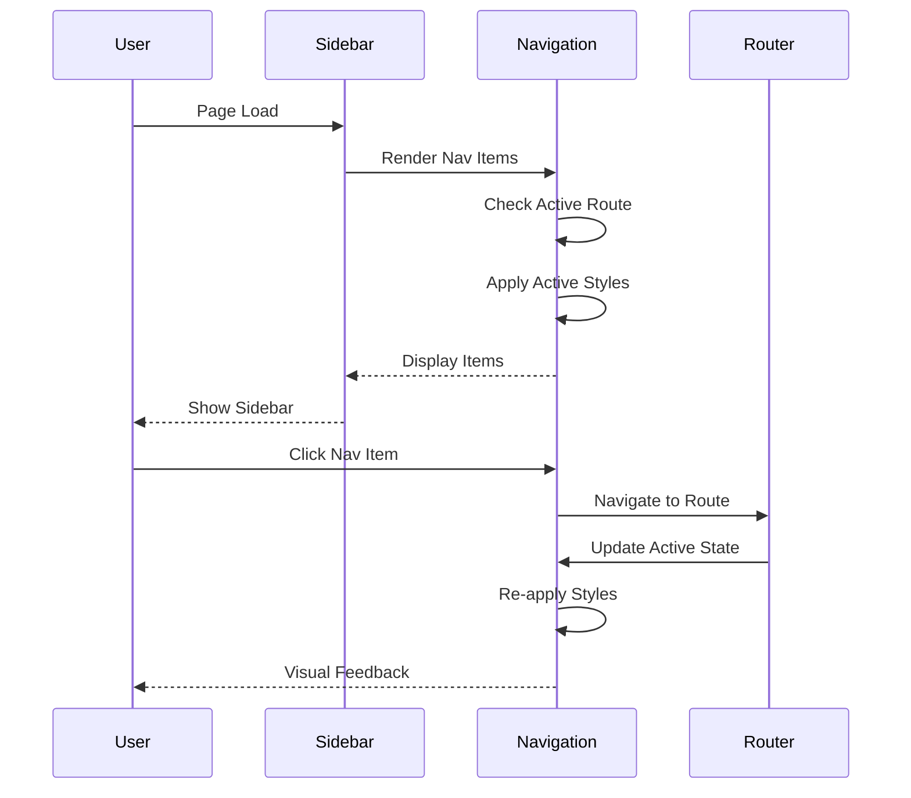

# Design Document: Sidebar UI Improvements

## Overview

This design document outlines comprehensive improvements to the Dashboard sidebar component to enhance readability and visual appeal. The primary objectives are to increase font sizes for better legibility and refine the overall layout, spacing, and visual hierarchy. The sidebar serves as the primary navigation interface, containing seven navigation items and a promotional "Upgrade to Pro" card. The improvements will maintain the existing dark theme with purple accent colors while enhancing usability through better typography and spacing.

The current implementation uses small text (text-sm/14px) for navigation labels and a fixed width of 210px. The design will increase font sizes, optimize spacing, improve visual hierarchy, and ensure the sidebar remains responsive and accessible across different screen sizes.

## Architecture

The sidebar is implemented as a fixed-position aside element within the Dashboard component. It uses Framer Motion for animations and Tailwind CSS for styling.

```mermaid
graph TD
    A[Dashboard Component] --> B[Sidebar Component]
    B --> C[Navigation Section]
    B --> D[Upgrade Card Section]
    C --> E[Navigation Items Array]
    E --> F[Icon Component]
    E --> G[Label Text]
    E --> H[Active State Styling]
    D --> I[Sparkles Icon]
    D --> J[Promotional Text]
    D --> K[Upgrade Button]
    
    style B fill:#6366f1,stroke:#8b5cf6,color:#fff
    style C fill:#1e1b4b,stroke:#6366f1
    style D fill:#1e1b4b,stroke:#6366f1
```



## Main Algorithm/Workflow



## Components and Interfaces

### Component 1: Sidebar Container

**Purpose**: Main container that holds navigation and promotional sections with fixed positioning

**Interface**:
```typescript
interface SidebarProps {
  // No props - self-contained component
}

interface SidebarStyles {
  position: 'fixed'
  width: string // Updated from 210px to 280px
  background: string
  borderRight: string
  backdropFilter: string
}
```

**Responsibilities**:
- Maintain fixed position on left side of viewport
- Provide glassmorphism background effect
- Handle entrance animations via Framer Motion
- Contain navigation and promotional sections

### Component 2: Navigation Section

**Purpose**: Renders the list of navigation items with active state management

**Interface**:
```typescript
interface NavItem {
  icon: LucideIcon
  label: string
  path: string
}

interface NavigationProps {
  items: NavItem[]
  currentPath: string
}

interface NavItemStyles {
  fontSize: string // Updated from text-sm to text-lg
  iconSize: string // Updated from 1rem to 1.5rem
  padding: string // Updated for better spacing
  activeBackground: string
  activeBorder: string
  activeColor: string
}
```

**Responsibilities**:
- Map through navigation items array
- Determine active state based on current route
- Apply appropriate styling for active/inactive states
- Handle hover interactions
- Render icons with labels

### Component 3: Upgrade Card

**Purpose**: Promotional card encouraging users to upgrade to Pro plan

**Interface**:
```typescript
interface UpgradeCardProps {
  // No props - static content
}

interface UpgradeCardStyles {
  iconSize: string // Updated from 1.2rem to 2rem
  titleFontSize: string // Updated from text-sm to text-lg
  descriptionFontSize: string // Updated from text-xs to text-base
  buttonFontSize: string // Updated from text-sm to text-lg
  padding: string // Updated for better spacing
}
```

**Responsibilities**:
- Display promotional content
- Render Sparkles icon
- Show upgrade button
- Maintain gradient styling
- Handle button click interactions

## Data Models

### Model 1: NavItem

```typescript
interface NavItem {
  icon: LucideIcon // Icon component from lucide-react
  label: string // Display text for navigation item
  path: string // Route path for navigation
}
```

**Validation Rules**:
- `icon` must be a valid Lucide icon component
- `label` must be non-empty string
- `path` must start with '/' and be a valid route

### Model 2: SidebarDimensions

```typescript
interface SidebarDimensions {
  width: number // Sidebar width in pixels
  topOffset: number // Distance from top (navbar height)
  bottomOffset: number // Distance from bottom
  padding: {
    horizontal: number // Left/right padding
    vertical: number // Top/bottom padding
  }
}
```

**Validation Rules**:
- `width` must be between 200px and 300px
- `topOffset` must match navbar height (64px)
- All padding values must be positive numbers

## Key Functions with Formal Specifications

### Function 1: renderNavItem()

```typescript
function renderNavItem(item: NavItem, index: number, isActive: boolean): JSX.Element
```

**Preconditions:**
- `item` is a valid NavItem object with all required fields
- `index` is a non-negative integer
- `isActive` is a boolean indicating current route match

**Postconditions:**
- Returns a valid JSX.Element wrapped in motion.div
- Element has proper styling based on `isActive` state
- Animation delay is calculated based on `index`
- Click handler navigates to `item.path`

**Loop Invariants:** N/A (no loops in function)

### Function 2: determineActiveState()

```typescript
function determineActiveState(currentPath: string, itemPath: string): boolean
```

**Preconditions:**
- `currentPath` is the current location pathname
- `itemPath` is the navigation item's target path

**Postconditions:**
- Returns `true` if paths match exactly
- Returns `false` otherwise
- No side effects on input parameters

**Loop Invariants:** N/A (no loops in function)

### Function 3: applyNavItemStyles()

```typescript
function applyNavItemStyles(isActive: boolean): CSSProperties
```

**Preconditions:**
- `isActive` is a boolean value

**Postconditions:**
- Returns object with background, color, and borderLeft properties
- Active state uses purple accent colors
- Inactive state uses muted gray colors
- All color values are valid CSS color strings

**Loop Invariants:** N/A (no loops in function)

## Algorithmic Pseudocode

### Main Rendering Algorithm

```pascal
ALGORITHM renderSidebar()
OUTPUT: JSX.Element representing complete sidebar

BEGIN
  // Initialize navigation items array
  navItems ← [
    {icon: LayoutDashboard, label: "Overview", path: "/dashboard"},
    {icon: Activity, label: "My Activity", path: "/doubts"},
    {icon: Bookmark, label: "Bookmarks", path: "/resources"},
    {icon: FolderOpen, label: "My Projects", path: "/communities"},
    {icon: Star, label: "XP & Rewards", path: "/dashboard#xp"},
    {icon: Award, label: "Achievements", path: "/dashboard#ach"},
    {icon: Settings, label: "Settings", path: "/settings"}
  ]
  
  // Get current location
  currentPath ← useLocation().pathname
  
  // Render sidebar container with animation
  RETURN (
    <motion.aside
      initial={{x: -80, opacity: 0}}
      animate={{x: 0, opacity: 1}}
      transition={{duration: 0.4, ease: "easeOut"}}
      className="fixed left-0 top-16 bottom-0 w-[280px] z-40 flex flex-col"
      style={{
        background: "rgba(5,3,20,0.85)",
        borderRight: "1px solid rgba(99,102,241,0.15)",
        backdropFilter: "blur(20px)"
      }}
    >
      {renderNavigationSection(navItems, currentPath)}
      {renderUpgradeCard()}
    </motion.aside>
  )
END
```

**Preconditions:**
- React hooks (useLocation) are available
- Framer Motion library is imported
- All icon components are imported

**Postconditions:**
- Returns complete sidebar JSX structure
- Sidebar is positioned fixed on left side
- All animations are configured
- Navigation and upgrade sections are rendered

**Loop Invariants:** N/A (uses map function internally)

### Navigation Section Rendering Algorithm

```pascal
ALGORITHM renderNavigationSection(navItems, currentPath)
INPUT: navItems (array of NavItem), currentPath (string)
OUTPUT: JSX.Element representing navigation section

BEGIN
  RETURN (
    <nav className="flex-1 px-4 py-6 space-y-2 overflow-y-auto">
      FOR each item IN navItems WITH index i DO
        Icon ← item.icon
        isActive ← (currentPath = "/dashboard" AND item.path = "/dashboard")
        
        RENDER (
          <motion.div
            key={item.label}
            initial={{opacity: 0, x: -20}}
            animate={{opacity: 1, x: 0}}
            transition={{delay: 0.05 * i}}
          >
            <Link
              to={item.path}
              className="flex items-center gap-3 px-5 py-4 rounded-xl text-lg font-medium transition-all duration-200"
              style={{
                background: isActive ? "rgba(99,102,241,0.2)" : "transparent",
                color: isActive ? "#a5b4fc" : "rgba(148,163,184,0.75)",
                borderLeft: isActive ? "3px solid #6366f1" : "3px solid transparent"
              }}
            >
              <Icon style={{
                width: "1.5rem",
                height: "1.5rem",
                color: isActive ? "#818cf8" : "rgba(148,163,184,0.5)",
                flexShrink: 0
              }} />
              <span className="text-lg">{item.label}</span>
            </Link>
          </motion.div>
        )
      END FOR
    </nav>
  )
END
```

**Preconditions:**
- `navItems` is a non-empty array of valid NavItem objects
- `currentPath` is a valid string representing current route

**Postconditions:**
- Returns navigation section with all items rendered
- Each item has staggered animation based on index
- Active state is correctly applied
- All items are clickable and navigate to correct routes

**Loop Invariants:**
- All previously rendered items have valid animation delays
- Animation delay increases monotonically with index
- All items maintain consistent styling structure

### Upgrade Card Rendering Algorithm

```pascal
ALGORITHM renderUpgradeCard()
OUTPUT: JSX.Element representing upgrade promotional card

BEGIN
  RETURN (
    <motion.div
      className="mx-4 mb-5 p-7 rounded-2xl text-center"
      style={{
        background: "linear-gradient(135deg, rgba(99,102,241,0.25), rgba(139,92,246,0.2))",
        border: "1px solid rgba(99,102,241,0.3)"
      }}
      initial={{opacity: 0, y: 20}}
      animate={{opacity: 1, y: 0}}
      transition={{delay: 0.5}}
    >
      // Icon container
      <div
        className="w-16 h-16 mx-auto mb-4 rounded-xl flex items-center justify-center"
        style={{background: "linear-gradient(135deg, #6366f1, #8b5cf6)"}}
      >
        <Sparkles style={{width: "2rem", height: "2rem", color: "white"}} />
      </div>
      
      // Title
      <p className="text-white text-lg font-bold mb-2">Upgrade to Pro</p>
      
      // Description
      <p
        className="text-base mb-5 leading-relaxed"
        style={{color: "rgba(148,163,184,0.7)"}}
      >
        Unlock premium features and grow faster.
      </p>
      
      // Button
      <button
        className="w-full py-3 rounded-lg text-lg font-semibold text-white"
        style={{
          background: "linear-gradient(135deg, #6366f1, #8b5cf6)",
          boxShadow: "0 4px 12px rgba(99,102,241,0.4)"
        }}
      >
        Upgrade Now
      </button>
    </motion.div>
  )
END
```

**Preconditions:**
- Sparkles icon component is imported
- Framer Motion is available

**Postconditions:**
- Returns complete upgrade card JSX structure
- Card has entrance animation with delay
- All text sizes are increased from original
- Button is interactive and styled

**Loop Invariants:** N/A (no loops in function)

## Example Usage

```typescript
// Example 1: Basic sidebar rendering in Dashboard
import { Sidebar } from './components/Sidebar'

function Dashboard() {
  return (
    <div className="min-h-screen">
      <Navbar />
      <Sidebar />
      <main className="ml-[280px] pt-16">
        {/* Dashboard content */}
      </main>
    </div>
  )
}

// Example 2: Navigation item with active state
const navItem = {
  icon: LayoutDashboard,
  label: 'Overview',
  path: '/dashboard'
}

const isActive = location.pathname === navItem.path
// Renders with purple background and border when active

// Example 3: Responsive layout adjustment
// Main content area accounts for sidebar width
<main className="ml-[280px] pt-16 px-6">
  {/* Content automatically positioned after sidebar */}
</main>
```

## Correctness Properties

*A property is a characteristic or behavior that should hold true across all valid executions of a system—essentially, a formal statement about what the system should do. Properties serve as the bridge between human-readable specifications and machine-verifiable correctness guarantees.*

### Property 1: Navigation Item Typography Consistency

*For any* navigation item, the label font size shall be 18px and the icon dimensions shall be 24px × 24px.

**Validates: Requirements 1.1, 1.2**

### Property 2: Navigation Item Padding Consistency

*For any* navigation item, the horizontal padding shall be 20px and the vertical padding shall be 16px.

**Validates: Requirement 2.2**

### Property 3: Adjacent Navigation Item Spacing

*For any* two adjacent navigation items, the vertical spacing between them shall be 8px.

**Validates: Requirement 2.4**

### Property 4: Active State Visual Properties

*For any* navigation item in active state, the item shall display: (1) purple background with 20% opacity, (2) 3px solid purple left border, (3) icon color #818cf8, and (4) label color #a5b4fc.

**Validates: Requirements 3.1, 3.2, 3.3, 3.4**

### Property 5: Inactive State Visual Properties

*For any* navigation item in inactive state, the item shall display: (1) transparent background, (2) icon color rgba(148,163,184,0.5), and (3) label color rgba(148,163,184,0.75).

**Validates: Requirements 3.5, 3.6, 3.7**

### Property 6: Active State Uniqueness

*For any* point in time, at most one navigation item shall be in active state.

**Validates: Requirement 5.8**

### Property 7: Animation Delay Monotonicity

*For any* navigation item at index i, the animation delay shall be exactly 0.05 * i seconds, ensuring monotonically increasing delays.

**Validates: Requirements 4.3, 4.5**

### Property 8: Global Sidebar Content Margin

*For any* page where the sidebar is rendered, the main content area shall have a left margin of 280px.

**Validates: Requirement 5.7**

### Property 9: Active Route Correspondence

*For any* page route, the navigation item with a path matching the current route shall be in active state.

**Validates: Requirement 5.8**

### Property 10: Sidebar Component Consistency

*For any* two instances of the sidebar component, the styling and behavior shall be identical.

**Validates: Requirement 6.4**

### Property 11: Filter Tab Status Filtering

*For any* selected filter tab and set of doubts, all displayed doubts shall have a status matching the filter criteria (or all statuses if "All" is selected).

**Validates: Requirements 8.2, 8.5**

### Property 12: Filter Tab Active State Styling

*For any* filter tab, if the tab is active it shall display highlighted background, otherwise it shall display neutral background.

**Validates: Requirements 8.3, 8.4**

### Property 13: Search Query Filtering

*For any* search query and set of doubts, all displayed doubts shall have title or description matching the search query.

**Validates: Requirement 9.2**

### Property 14: View Mode Toggle

*For any* current view mode (grid or list), clicking the view toggle shall switch to the opposite view mode.

**Validates: Requirement 9.4**

### Property 15: Doubt Card Required Fields

*For any* doubt card, the card shall display all of: (1) status badge, (2) title, (3) description, (4) topic and tags, (5) reply count, (6) timestamp, and (7) action buttons.

**Validates: Requirements 10.1, 10.2, 10.3, 10.4, 10.5, 10.6, 10.7**

### Property 16: Doubt Card Hover Effect

*For any* doubt card, when hovered the card shall display an elevation effect.

**Validates: Requirement 10.8**

### Property 17: Quick Actions Button Behavior

*For any* button in the Quick Actions section, clicking the button shall navigate to the appropriate page or trigger the appropriate action.

**Validates: Requirement 11.3**

### Property 18: Keyboard Navigation Order

*For any* navigation item at index i, the tab order shall be sequential such that item i is focusable before item i+1.

**Validates: Requirement 13.1**

### Property 19: Focus Indicator Visibility

*For any* navigation item that receives keyboard focus, the item shall display a visible focus indicator.

**Validates: Requirement 13.2**

### Property 20: Touch Target Accessibility

*For any* navigation item, the touch target size shall be at least 44px × 44px.

**Validates: Requirement 13.5**

### Property 21: Navigation Performance

*For any* navigation item click, the route transition shall complete within 100ms.

**Validates: Requirement 15.3**

## Error Handling

### Error Scenario 1: Invalid Route Navigation

**Condition**: User clicks navigation item with invalid or non-existent path
**Response**: React Router handles invalid routes by showing 404 or redirecting to default route
**Recovery**: User can click other navigation items to navigate to valid routes

### Error Scenario 2: Missing Icon Component

**Condition**: NavItem references an icon component that is not imported
**Response**: React throws error during render, component fails to mount
**Recovery**: Development error - must be fixed by importing correct icon component

### Error Scenario 3: Animation Library Failure

**Condition**: Framer Motion fails to load or initialize
**Response**: Sidebar renders without animations, static display
**Recovery**: Graceful degradation - sidebar remains functional without animations

### Error Scenario 4: Responsive Layout Overflow

**Condition**: Viewport width is too narrow to accommodate sidebar
**Response**: Sidebar may overlap content or require horizontal scroll
**Recovery**: Implement responsive breakpoints to hide/collapse sidebar on mobile devices

## Testing Strategy

### Unit Testing Approach

**Test Cases**:
1. **Font Size Verification**: Assert all navigation labels use text-lg class
2. **Icon Size Verification**: Assert all icons have width and height of 1.5rem
3. **Active State Logic**: Test determineActiveState() with various path combinations
4. **Style Application**: Test applyNavItemStyles() returns correct CSS for active/inactive states
5. **NavItem Rendering**: Test each navigation item renders with correct icon and label
6. **Upgrade Card Content**: Verify all text content and button are present

**Coverage Goals**: 90%+ code coverage for component logic

### Property-Based Testing Approach

**Property Test Library**: fast-check (for JavaScript/TypeScript)

**Properties to Test**:

1. **Font Size Invariant**:
```typescript
fc.assert(
  fc.property(fc.array(navItemGenerator), (items) => {
    const rendered = renderNavigationItems(items)
    return items.every(item => 
      getFontSize(rendered, item.label) === '18px'
    )
  })
)
```

2. **Animation Delay Ordering**:
```typescript
fc.assert(
  fc.property(fc.array(navItemGenerator), (items) => {
    const delays = items.map((_, i) => 0.05 * i)
    return delays.every((delay, i) => 
      i === 0 || delay > delays[i - 1]
    )
  })
)
```

3. **Active State Exclusivity**:
```typescript
fc.assert(
  fc.property(fc.string(), fc.array(navItemGenerator), (currentPath, items) => {
    const activeItems = items.filter(item => 
      determineActiveState(currentPath, item.path)
    )
    return activeItems.length <= 1
  })
)
```

### Integration Testing Approach

**Test Scenarios**:
1. **Full Sidebar Render**: Mount complete sidebar and verify all sections present
2. **Navigation Flow**: Click each navigation item and verify route changes
3. **Active State Updates**: Navigate between routes and verify active styling updates
4. **Animation Sequence**: Verify staggered animations play in correct order
5. **Responsive Behavior**: Test sidebar at different viewport widths

## Performance Considerations

### Optimization 1: Animation Performance
- Use Framer Motion's hardware-accelerated transforms (x, opacity)
- Avoid animating expensive properties like width or height
- Stagger animations to prevent simultaneous reflows

### Optimization 2: Re-render Prevention
- Navigation items array should be memoized or defined outside component
- Use React.memo for individual navigation items if performance issues arise
- Active state calculation is lightweight (simple string comparison)

### Optimization 3: CSS Performance
- Use transform and opacity for animations (GPU-accelerated)
- Backdrop filter is expensive but acceptable for fixed sidebar
- Avoid box-shadow on every item (only on hover/active)

### Optimization 4: Bundle Size
- Lucide icons are tree-shakeable (only import used icons)
- Framer Motion adds ~30KB gzipped (acceptable for animation features)

## Security Considerations

### Security 1: Route Validation
- All navigation paths should be validated against allowed routes
- Prevent navigation to unauthorized or non-existent routes
- Use React Router's built-in route protection mechanisms

### Security 2: XSS Prevention
- Navigation labels are static strings (no user input)
- If labels become dynamic, sanitize all user-provided content
- React's JSX automatically escapes content

### Security 3: Click Hijacking
- Ensure navigation links cannot be overlaid by malicious elements
- Use appropriate z-index values
- Sidebar has z-40, should be below modals but above content

## Dependencies

### Core Dependencies
- **React** (^18.x): Component framework
- **React Router DOM** (^6.x): Navigation and routing
- **Framer Motion** (^10.x): Animation library
- **Lucide React** (^0.x): Icon library
- **Tailwind CSS** (^3.x): Utility-first CSS framework

### Development Dependencies
- **TypeScript** (optional): Type safety
- **fast-check**: Property-based testing
- **@testing-library/react**: Component testing
- **@testing-library/user-event**: User interaction testing

### Browser Requirements
- Modern browsers with CSS backdrop-filter support
- Flexbox support (all modern browsers)
- CSS custom properties support
- JavaScript enabled for React and animations

## Implementation Summary

### Key Changes from Current Implementation

| Aspect | Current | Improved |
|--------|---------|----------|
| Sidebar Width | 210px | 280px |
| Nav Label Font | text-sm (14px) | text-lg (18px) |
| Icon Size | 1rem (16px) | 1.5rem (24px) |
| Nav Item Padding | px-4 py-3 | px-5 py-4 |
| Nav Section Padding | px-2 py-4 | px-4 py-6 |
| Nav Item Spacing | space-y-0.5 | space-y-2 |
| Upgrade Icon Size | 1.2rem | 2rem |
| Upgrade Icon Container | w-12 h-12 | w-16 h-16 |
| Upgrade Title Font | text-sm (14px) | text-lg (18px) |
| Upgrade Description Font | text-xs (12px) | text-base (16px) |
| Upgrade Button Font | text-sm (14px) | text-lg (18px) |
| Upgrade Card Padding | p-5 | p-7 |
| Upgrade Title Margin | mb-2 | mb-4 |
| Upgrade Description Margin | mb-3 | mb-5 |
| Upgrade Button Padding | py-2 | py-3 |

### Visual Hierarchy Improvements

1. **Typography Scale**: Increased font sizes create clearer hierarchy
2. **Icon Prominence**: Larger icons (20px) improve scannability
3. **Spacing Rhythm**: Increased padding and margins improve breathing room
4. **Touch Targets**: Larger clickable areas improve mobile usability
5. **Visual Balance**: Icon-to-text ratio maintains harmony

### Accessibility Improvements

1. **Readability**: Larger fonts improve readability for users with visual impairments
2. **Touch Targets**: Increased padding creates larger touch targets (minimum 44x44px recommended)
3. **Color Contrast**: Existing color scheme maintains WCAG AA contrast ratios
4. **Focus States**: Existing transition effects provide clear focus indicators
5. **Semantic HTML**: Link elements with proper navigation structure

### Responsive Considerations

While the current design maintains a fixed sidebar, future enhancements could include:
- Collapsible sidebar on tablet/mobile (< 1024px)
- Hamburger menu toggle for small screens
- Icon-only mode for narrow viewports
- Overlay mode for mobile devices

These responsive features are not included in the current scope but should be considered for future iterations.
